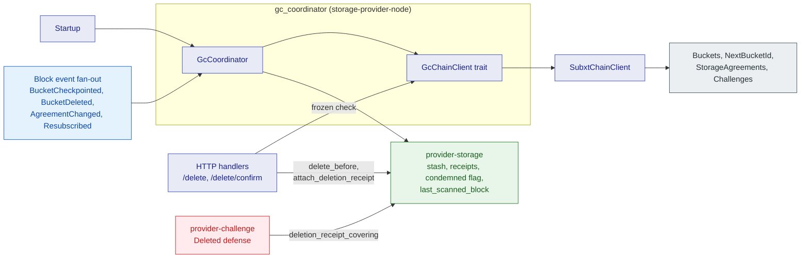
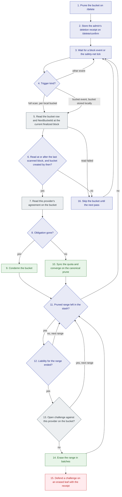

# Garbage Collector

## 1. Overview

`gc_coordinator` is the provider node's garbage collector.
It erases pruned data from disk only after the chain confirms that no challenge can reach it, condemns buckets whose on-chain obligation ended, and keeps each bucket's quota equal to the agreement on chain.
Deletion has two phases: `/delete` prunes leaves into the retention stash described in [provider-storage](provider-storage.md), and this module later erases each stashed range once liability for it has passed.
This document is for engineers who change when the node erases data, how it reacts to bucket and agreement events, or how a challenge on erased data is defended.

## 2. Position in the node

Callers: `command.rs` starts the coordinator at startup when the node has a signing chain client.
The chain-state coordinator's block events and a safety-net interval trigger its passes.

Callees: `GcChainClient`, which the node implements on `SubxtChainClient`, and the `StorageBackend` for the pruned ranges, the deletion receipts, the condemned flag, the bucket quota and the stored `last_scanned_block`.

Related paths: `/delete` and `/delete/confirm` in `api.rs` produce the stash and the receipts the coordinator needs.
The challenge responder reads the receipts to answer a challenge on an erased leaf with the `Deleted` defense.

External interfaces: chain reads of `Buckets`, `NextBucketId`, this provider's `StorageAgreements` entry and `Challenges`.
No extrinsics and no HTTP endpoints of its own; the coordinator reads the chain and writes the local DB.

## 3. How It Works

The main workflow is the life of one pruned range: prune, receipt, reconcile, erase, defend.
Steps 1 and 2 run in the HTTP handlers; steps 3 to 14 and 16 run in the coordinator loop; step 15 runs in the challenge responder.

## 4. Explain

1. **Prune the bucket on /delete.**
   Input: bucket id and the new start sequence, from a caller with the admin role.
   Output: the leaves before the new start sequence moved into a `PrunedRange`, and the post-prune `Commitment` signed by the provider in the response.
   Before the prune the handler reads the bucket row from chain: a frozen bucket is append-only and rejects the prune with `403 bucket_frozen`, and an unreadable chain rejects it with `503 chain_state_unavailable`, because a prune cannot be undone and must not run on a stale answer.
   A node without a chain client skips the check, because nothing can be frozen without a chain.
   The pruned bytes stay on disk; see steps 14 and 15 of [provider-storage](provider-storage.md).

2. **Store the admin's deletion receipt on /delete/confirm.**
   Input: bucket id, the post-prune MMR root, the new start sequence, the admin account and the admin's `MultiSignature` over `CommitmentPayload(bucket_id, Commitment { mmr_root, start_seq: new_start_seq, leaf_count: 0 })`.
   Output: a `DeletionReceipt` stored under the new start sequence; a repeated request for the same sequence replaces the previous receipt.
   The handler requires the admin role, requires the receipt's admin to be the account that signed the request, and the backend verifies the signature, requires a stashed range that ends at the new start sequence, and rejects a condemned bucket.
   The signed payload is the one the pallet's `Deleted` defense verifies, so a receipt the node accepts is one the chain accepts.
   Deletion is two requests because only the provider can compute the post-prune commitment the admin signs.

3. **Wait for a block event or the safety-net tick.**
   Input: the broadcast subscription and the interval timer.
   Output: one trigger for the loop.
   The subscription is taken before the block follower starts, so the first `Resubscribed` event is not missed.
   The first tick fires at startup and is the bootstrap pass.

4. **Trigger kind?**
   Input: the trigger from step 3.
   Output: a `Resubscribed` event, a lagged channel or a tick continues with every locally stored bucket in turn; a `BucketCheckpointed`, `BucketDeleted` or `AgreementChanged` event continues with that bucket when it is stored locally; every other event returns to waiting.
   `BucketDeleted` is one-shot, because the bucket row is gone afterwards; a missed one is found by the full scan as a local bucket with no chain row.

5. **Read the bucket row and NextBucketId at the current finalized block.**
   Input: bucket id.
   Output: a `CanonicalBucketState` with the block number of the read, whether the bucket row exists, `NextBucketId` at that block, the frozen start sequence and the canonical start sequence from the bucket's snapshot.
   A missing row is a definite answer; a failed read is an error and continues at step 16.

6. **Read at or after the last scanned block, and bucket created by then?**
   Input: the `CanonicalBucketState` and the stored `last_scanned_block`.
   Output: no continues at step 16; yes stores the block number as the new `last_scanned_block` when it is higher and continues.
   A read below the stored block is older than one already acted on and is not trusted.
   A missing row for a bucket id at or above `NextBucketId` means the read predates the bucket's creation, not that the bucket was deleted.
   The block number check does not detect a different chain: on a chain below the stored block the coordinator skips every bucket until that height is reached.

7. **Read this provider's agreement on the bucket.**
   Input: bucket id and the provider account.
   Output: the agreement's `max_bytes`, or none when no agreement row exists.
   The read is skipped when the bucket row is gone.
   A failed read continues at step 16.

8. **Obligation gone?**
   Input: the bucket row and the agreement.
   Output: yes, when the bucket row or this provider's agreement is gone, continues with the condemnation; no continues with the quota sync.
   When the obligation exists, the coordinator forgets any earlier observation that it was gone.

9. **Condemn the bucket.**
   Input: bucket id.
   Output: every retained leaf queued as one pruned range, the bucket marked condemned, and `store_node` and `commit` rejecting the bucket with `BucketCondemned` from then on.
   A call on a bucket that is already condemned changes nothing, except that it resumes a record removal that stopped part way.

10. **Sync the quota and converge on the canonical prune.**
    Input: the agreement's `max_bytes`, the canonical start sequence and the local bucket state.
    Output: the local quota equal to the agreement, and, when the canonical start sequence is ahead of the local one, the local bucket pruned to it.
    The prune covers canonical prunes the node did not perform itself: a replica never receives `/delete`, and a restored node may be behind.

11. **Pruned range left in the stash?**
    Input: bucket id.
    Output: no returns to waiting; yes continues with the next range, oldest first.
    Each `PrunedRangeInfo` reports the range's sequences and whether a receipt for it exists.

12. **Liability for the range ended?**
    Input: the range, the `CanonicalBucketState` and the condemned flag.
    Output: yes continues with the challenge check; no continues with the next range.
    On a bucket that is not condemned, liability ends when the canonical start sequence has reached the range's new start sequence, so `challenge_checkpoint` cannot cite it, and a receipt is stored, so `challenge_offchain` on an older signed commitment is answered with the `Deleted` defense.
    On a condemned bucket, liability ends when a pass at a block newer than the first pass that saw the obligation gone confirms it is still gone; the first observation only records its block.

13. **Open challenge against this provider on the bucket?**
    Input: bucket id.
    Output: yes defers the erase and continues with the next range; no continues with the erase.
    The read happens at most once per pass, and only once a range is otherwise ready.
    A failed read continues at step 16.

14. **Erase the range in batches.**
    Input: bucket id and the range's first sequence.
    Output: the refcount of each node under the erased leaves decreased, zero-refcount nodes deleted, the charged bytes credited back, and the range's `erased_leaves` advanced, in one transaction per batch of whole leaves up to `ERASE_BATCH_NODES` distinct nodes.
    The leaves themselves remain, because a commitment signed before the prune also covers later leaves and its proof needs them.
    The range record is dropped once every leaf is erased; on a condemned bucket the bucket's records are removed once no retained leaf and no range remains.
    A later call resumes after the batches already applied.

15. **Defend a challenge on an erased leaf with the receipt.**
    Input: a challenge whose MMR proof or chunk fetch failed, and the challenged sequence (the cited start sequence plus the leaf index).
    Output: the stored receipt with the smallest new start sequence above the challenged sequence submitted as the `Deleted` response, or the original proof failure when no receipt covers the leaf.

16. **Skip the bucket until the next pass.**
    Input: the failed read or the rejected read from step 5, 6, 7 or 13, or a storage error.
    Output: a warning logged, and the bucket left unchanged until the next event or tick.
    Every decision re-reads chain state, so a skipped bucket is retried from scratch.

## 5. Failure handling

| Error case | Action |
| --- | --- |
| Chain read of the bucket, the agreement or the challenges fails | Log a warning and skip the bucket; the next event or tick retries. Nothing is erased on an unreadable chain. |
| Chain read older than `last_scanned_block` | Skip the bucket. |
| Bucket row missing and bucket id at or above `NextBucketId` | Skip the bucket; the read predates the bucket. |
| Open challenge against this provider on the bucket | Defer every erase on the bucket to a later pass. |
| Obligation first seen gone on a condemned bucket | Record the block; erase only on a later pass at a newer block that still sees it gone. |
| Erase batch fails part way | The batches already applied remain; the next pass resumes from `erased_leaves`. |
| Leaf tree incomplete during an erase | Apply the decrements for the nodes reached and log a warning; unreached nodes keep their count and are not deleted. |
| Refcount entry missing during an erase | Keep the node and log a warning. |
| `/delete` on a frozen bucket | Reject with `403 bucket_frozen`. |
| `/delete` chain read fails | Reject with `503 chain_state_unavailable`; the caller retries. |
| `/delete/confirm` signature does not verify | Reject with `400 invalid_signature`; nothing is stored. |
| `/delete/confirm` admin differs from the request signer | Reject with `403 not_authorized`. |
| `/delete/confirm` new start sequence ends no stashed range | Reject with `400` (`InvalidStartSeq`). |
| `/delete/confirm`, `/node` or `/commit` on a condemned bucket | Reject with `410 bucket_condemned`. |
| Event channel lagged | Run a full scan. |
| Event channel closed | Stop consuming events; the safety-net interval remains. |
| No signing chain client (`--keyfile` absent) | The coordinator does not start and `/delete` skips the frozen check; pruned ranges remain in the stash. |

After a crash or restart: the pruned ranges, their `erased_leaves` progress, the deletion receipts, the condemned flags and `last_scanned_block` are on disk.
The block of the first pass that saw an obligation gone is in memory only, so a condemned bucket needs two passes after a restart before its erase.
The first interval tick runs a full scan, so pending erases resume without an event.
Nothing is written on chain by the coordinator; the `Deleted` response is submitted by the challenge responder.

## 6. References

- Prune and erase mechanics: steps 14 to 18 of [provider-storage](provider-storage.md).
- Challenge flow the `Deleted` defense extends: steps 8 to 12 of [provider-challenge](provider-challenge.md).
- Design: [Bucket Semantics](../scalable-web3-storage-implementation.md#bucket-semantics), [Provider Lifecycle in Bucket](../scalable-web3-storage-implementation.md#provider-lifecycle-in-bucket) and [Challenge Protocol](../scalable-web3-storage-implementation.md#challenge-protocol) in the implementation design.
