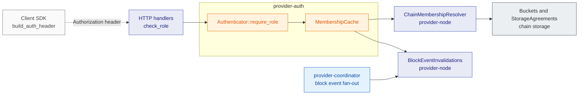
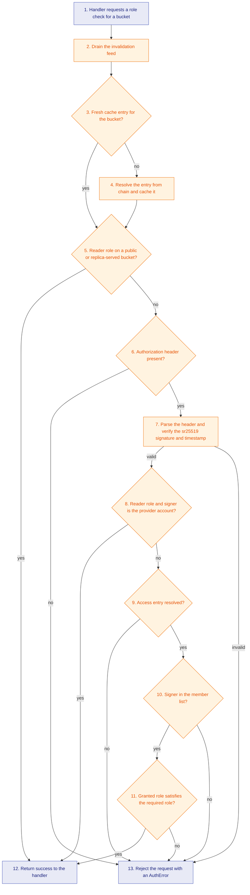

# provider-auth

## 1. Overview

`provider-auth` decides whether an HTTP request may act on a bucket.
It verifies the signed `Authorization` header a client sends and maps the signer to the role the bucket grants on chain, so the provider node serves writes only to writers, deletes only to admins, and bucket-bound reads on private buckets only to members.
This document is for engineers who change the request authentication path or the membership cache behind it.

## 2. Position in the node

Callers: the HTTP handlers in `storage-provider-node` that call `check_role`: `PUT /node`, `POST /exists`, `POST /commit`, `GET /commitment`, `GET /checkpoint-signature`, `GET /mmr_proof`, `POST /delete`, `GET /mmr_peaks`, `GET /replica/historical_roots` and `GET /replica/sync_status`.
The hash-keyed reads `GET /node`, `GET /read`, `GET /chunk_proof` and `POST /fetch_nodes` bypass it by design: possession of the hash is the read capability.
The client SDK uses the same crate to build the header it sends.

Callees: a `MembershipResolver` and a `MembershipInvalidations` feed.
The node supplies `ChainMembershipResolver`, which reads `Buckets` and the node's own `StorageAgreements` entry, and `BlockEventInvalidations`, which drains the block event fan-out of `provider-coordinator`.

External interfaces: chain storage reads through the resolver.
No extrinsics, no HTTP endpoints of its own, no local DB.
The cache is in memory only.

## 3. How It Works

## 4. Explain

1. **Handler requests a role check for a bucket.**
   Input: the optional `Authorization` header, the HTTP method, the bucket id and the `RequiredRole` (`Reader`, `Writer` or `Admin`).
   Output: a call into the authenticator.
   Implemented by [`check_role`](../../../provider-node/src/api.rs) in the node, which calls [`Authenticator::require_role`](../../../crates/providers/auth/src/verify.rs).

2. **Drain the invalidation feed.**
   Input: every event the feed received since the previous lookup.
   Output: an `Invalidation` value: nothing, a list of bucket ids to drop, or everything.
   A lagged, restarted or scope-unknown feed drops every cached entry.
   Draining runs synchronously before the cache lookup, so an event that arrived before this request takes effect on this request.
   Implemented by [`MembershipInvalidations::drain`](../../../crates/providers/auth/src/membership.rs) and the private `MembershipCache::drain_invalidations`.

3. **Fresh cache entry for the bucket?**
   Input: the bucket id and the cache TTL.
   Output: yes when the cache contains an entry younger than the TTL, which the lookup returns as is; no on a miss or a stale entry.
   Implemented by the private `MembershipCache::lookup` and `CachedMembership::is_fresh` in [`membership.rs`](../../../crates/providers/auth/src/membership.rs).

4. **Resolve the entry from chain and cache it.**
   Input: the bucket id.
   Output: a `CachedMembership` containing the member list, the bucket visibility and whether this node serves the bucket as a replica, or a `MembershipError` when the chain read fails.
   Both resolver calls run, and the cache inserts the result only if no invalidation landed during the fetch, which the cache detects with an epoch counter.
   On a failed read the lookup returns a stale entry within `max_stale` instead of the error.
   Implemented by [`MembershipResolver::fetch_access`](../../../crates/providers/auth/src/membership.rs), [`MembershipResolver::fetch_serves_as_replica`](../../../crates/providers/auth/src/membership.rs) and the private `MembershipCache::lookup`.

5. **Reader role on a public or replica-served bucket?**
   Input: the required role and the result of step 3 or 4.
   Output: yes when the role is `Reader` and the entry resolved with `Public` visibility or with this node serving the bucket under a replica agreement; the request succeeds without a header.
   Replicas serve everyone; visibility gates primaries only.
   Implemented by [`Authenticator::require_role`](../../../crates/providers/auth/src/verify.rs).

6. **Authorization header present?**
   Input: the optional header.
   Output: no rejects with `AuthRequired`; yes continues to signature verification.
   Implemented by `require_role`.

7. **Parse the header and verify the sr25519 signature and timestamp.**
   Input: the `Web3Storage <pubkey_hex>:<signature_hex>:<timestamp>` header.
   Output: the signer's `AccountId32`, or `AuthRequired` for a malformed header or an invalid signature, or `TimestampExpired` for a timestamp that does not parse or is outside the skew.
   The message is `web3storage:<METHOD>:<bucket_id>:<timestamp>`, rebuilt by [`auth_message`](../../../crates/providers/auth/src/http_auth.rs).
   The timestamp must lie within the configured skew of the node clock.
   `verify_signature` accepts both the raw message and the `<Bytes>`-wrapped form that wallet signers produce.
   Implemented by the private `verify_signature` in [`verify.rs`](../../../crates/providers/auth/src/verify.rs).

8. **Reader role and signer is the provider account?**
   Input: the signer account and the node's own provider account.
   Output: yes succeeds at once; no continues to the membership check.
   This check runs before `require_role` reads the membership result, so operator reads keep working during a chain outage.
   Implemented by [`Authenticator::with_provider_account`](../../../crates/providers/auth/src/verify.rs) and `require_role`.

9. **Access entry resolved?**
   Input: the result of step 3 or 4.
   Output: no rejects with `MembershipLookup`, which contains the `MembershipError` from step 4; yes continues with the entry.
   Implemented by `require_role`.

10. **Signer in the member list?**
    Input: the access entry and the signer account.
    Output: yes continues with the granted `Role`; no rejects with `InsufficientRole`.
    Implemented by the private `CachedMembership::role_of` in [`membership.rs`](../../../crates/providers/auth/src/membership.rs).

11. **Granted role satisfies the required role?**
    Input: the granted role and the required role.
    Output: yes when the granted role is at least the required one; no rejects with `InsufficientRole`.
    Implemented by [`RequiredRole::is_satisfied_by`](../../../crates/providers/auth/src/membership.rs).

12. **Return success to the handler.**
    Input: the `Ok` result.
    Output: the handler continues with its storage work.
    Implemented by the caller, [`check_role`](../../../provider-node/src/api.rs).

13. **Reject the request with an AuthError.**
    Input: the `AuthError` from step 6, 7, 9, 10 or 11.
    Output: an HTTP error response; the mapping to status codes is in section 5.
    Implemented by [`check_role`](../../../provider-node/src/api.rs) and [`AuthError`](../../../crates/providers/auth/src/error.rs).

## 5. Failure handling

| Error case | Action |
| --- | --- |
| Header missing, malformed, or signature does not verify | Reject with `AuthError::AuthRequired`; the node answers `401`. |
| Timestamp unparsable or outside the skew window | Reject with `AuthError::TimestampExpired`; the node answers `401`. |
| Signer is not a member, or role too low | Reject with `AuthError::InsufficientRole`; the node answers `403`. |
| Chain unreachable during a refetch | Serve the cached entry if one is still resident (stale-if-error, bounded by `--auth-max-stale`); otherwise reject with `MembershipError::Unavailable`, which the node maps to `503`. The feed is drained again first so a known-stale set is not served. |
| The `Buckets` or `StorageAgreements` entry exists but does not decode | Reject with `MembershipError::Decode`; the node answers `500`. No fallback to a lesser role. |
| Bucket does not exist on chain | Resolve as a private bucket with no members, so every request needs a role nobody has. |
| Invalidation lands while a fetch is in flight | The epoch moved, so the inserted entry is removed again and the next request re-resolves. |
| Feed lagged, resubscribed, or reports an unattributable membership event | Drop every cached entry. |
| Feed closed because the follower stopped | Log once and continue with TTL-only expiry. Authorization does not fail closed. |
| Cache at its entry cap | The underlying cache evicts; the cost is one re-resolve on the next request. |

After a crash or restart: nothing remains.
The cache is memory only, starts empty, and re-resolves each bucket from chain on first use.
Nothing is written on chain by this crate.

## 6. References

- Node-side resolver and feed: [`provider-node/src/membership.rs`](../../../provider-node/src/membership.rs).
- Design: [Authentication & RBAC](../scalable-web3-storage-implementation.md#authentication--rbac) in the implementation design; [Bucket Visibility & Access](../scalable-web3-storage.md#bucket-visibility--access) and [Read access at Layer 0](../scalable-web3-storage.md#read-access-at-layer-0) in the main design.
