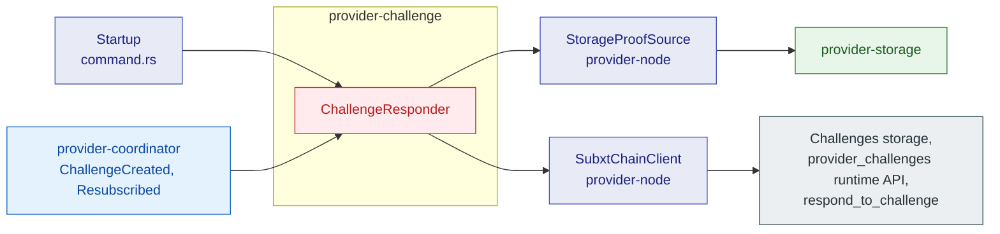
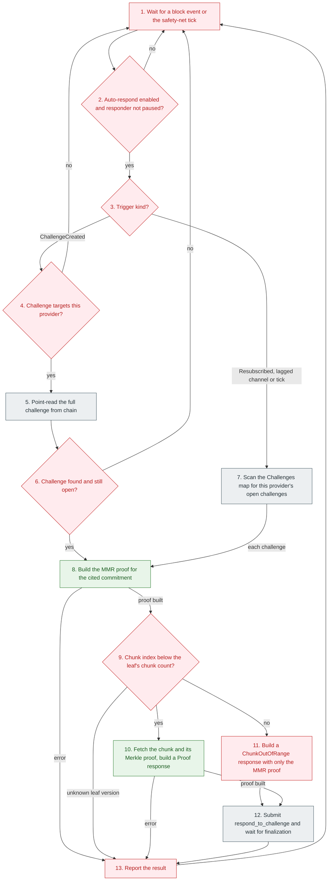

# provider-challenge

## 1. Overview

`provider-challenge` is the background service that answers on-chain challenges against this provider.
A challenge names a bucket, a commitment and a chunk; the service builds the MMR proof and the chunk proof from local storage and submits them before the deadline, which keeps the provider's stake from being slashed.
This document is for engineers who change how challenges are detected, proved or submitted.

## 2. Position in the node

Callers: `storage-provider-node` starts the responder at startup when `--enable-challenge-responder` is set and a signing chain client exists.
`provider-coordinator` feeds it `BlockEvent`s through the `provider-events` broadcast channel.

Callees: a `ChallengeProofSource` for local proof data and a `ChallengeChainClient` for chain access.
The node supplies `StorageProofSource`, an adapter over `provider-storage`, and `SubxtChainClient`.

External interfaces: the `provider_challenges` runtime API and the `Challenges` storage map for reads, and the `respond_to_challenge` extrinsic for writes.
No HTTP endpoints.
The local DB is reached only through the proof source.

## 3. How It Works

## 4. Explain

1. **Wait for a block event or the safety-net tick.**
   Input: the broadcast subscription, the command channel and the interval timer.
   Output: one trigger for the loop.
   Control commands on the command channel take priority over events and ticks.
   A `RespondTo` command starts at step 8 with the given challenge.
   The first tick fires at startup and is the bootstrap scan when the poll interval is non-zero.
   Implemented by the private `ChallengeResponder::run_loop` in [`lib.rs`](../../../crates/providers/challenge/src/lib.rs), started by [`ChallengeResponder::start`](../../../crates/providers/challenge/src/lib.rs).

2. **Auto-respond enabled and responder not paused?**
   Input: `auto_respond` from the config and the pause flag set by `Pause` and `Resume` commands.
   Output: no ignores the trigger; yes continues.
   While paused, events stay queued in the channel and the loop replays them on resume; with auto-respond disabled the loop drains and drops them.
   The loop also ignores a tick when the poll interval is zero.
   Implemented by `run_loop` using [`ChallengeResponderConfig`](../../../crates/providers/challenge/src/lib.rs) and [`ResponderCommand`](../../../crates/providers/challenge/src/lib.rs).

3. **Trigger kind?**
   Input: the trigger from step 1.
   Output: a `BlockEvent::ChallengeCreated` continues to the provider filter; a `Resubscribed` event, a lagged channel or an interval tick continues to the full scan.
   The loop ignores other block events.
   Implemented by `run_loop`.

4. **Challenge targets this provider?**
   Input: the event's provider account and the configured `provider_account`.
   Output: no drops the event; yes continues.
   Implemented by `run_loop`.

5. **Point-read the full challenge from chain.**
   Input: the `(deadline, index)` challenge id.
   Output: an optional `DetectedChallenge` with the cited `Commitment` and the `ChunkLocation` to prove.
   The event contains the id but not the proof parameters, so the responder needs this read.
   Implemented by [`ChallengeChainClient::fetch_challenge`](../../../crates/providers/challenge/src/lib.rs); the node's [`SubxtChainClient`](../../../provider-node/src/subxt_client.rs) reads the `Challenges` map.

6. **Challenge found and still open?**
   Input: the result of step 5.
   Output: no returns to waiting, because the challenge is already resolved, targets another provider, or the read failed; yes continues with the proof.
   Implemented by `run_loop`.

7. **Scan the Challenges map for this provider's open challenges.**
   Input: the chain client.
   Output: every open `DetectedChallenge` against this provider, each one passed through steps 8 to 13 in turn.
   The loop logs a failed scan and returns to waiting.
   Implemented by the private `ChallengeResponder::scan_and_respond` over [`ChallengeChainClient::poll_challenges`](../../../crates/providers/challenge/src/lib.rs).

8. **Build the MMR proof for the cited commitment.**
   Input: bucket id, the cited commitment and the leaf index.
   Output: an `MmrProof` whose leaf contains the data root and data size, or a `DataNotFound` result when the error risks slashing and `ProofGenerationFailed` otherwise.
   The proof is rebuilt for the exact commitment, because later commits or prunes may have moved the live MMR past it.
   Implemented by [`ChallengeProofSource::get_mmr_proof_for_commitment`](../../../crates/providers/challenge/src/lib.rs); the node's [`StorageProofSource`](../../../provider-node/src/challenge_proofs.rs) delegates to `provider-storage`.

9. **Chunk index below the leaf's chunk count?**
   Input: the challenged chunk index and the leaf's chunk count derived from its data size.
   Output: yes continues with the chunk fetch; no continues with the out-of-range response.
   A leaf with an unknown version has no chunk count and reports `ProofGenerationFailed`.
   Implemented by the private `ChallengeResponder::respond_to_challenge`.

10. **Fetch the chunk and its Merkle proof, build a Proof response.**
    Input: the leaf's data root and the chunk index.
    Output: `ChallengeResponse::Proof` with the chunk bytes, the sibling hashes up to the data root and the MMR proof, or a `DataNotFound` result when the error risks slashing and `ProofGenerationFailed` otherwise.
    Implemented by [`ChallengeProofSource::get_chunk_at_index`](../../../crates/providers/challenge/src/lib.rs).

11. **Build a ChunkOutOfRange response with only the MMR proof.**
    Input: the MMR proof from step 8.
    Output: `ChallengeResponse::ChunkOutOfRange`, which proves that the leaf has no chunk at the challenged index.
    Implemented by `respond_to_challenge`.

12. **Submit respond_to_challenge and wait for finalization.**
    Input: the challenge id and the `ChallengeResponse`.
    Output: the finalized block hash, or zero when the client inferred success from a duplicate rejection.
    The node's client serializes submissions, retries once on transport failure, and treats a duplicate rejection on the retry as success.
    Implemented by [`ChallengeChainClient::submit_response`](../../../crates/providers/challenge/src/lib.rs) and [`SubxtChainClient::submit_response`](../../../provider-node/src/subxt_client.rs).

13. **Report the result.**
    Input: the outcome of steps 8 to 12.
    Output: a `ChallengeResponseResult` passed to the optional callback and logged, after which the loop returns to waiting.
    Implemented by [`ChallengeResponseResult`](../../../crates/providers/challenge/src/lib.rs).

## 5. Failure handling

| Error case | Action |
| --- | --- |
| Proof data provably absent: bucket unknown, leaves pruned past the cited window, node or chunk missing | Report `DataNotFound`. No retry helps; `ChallengeError::risks_slashing` is true. The challenge expires on chain and the stake is slashed unless the data is restored before the deadline. |
| Storage backend error while building a proof | Report `ProofGenerationFailed`. The next full scan retries. |
| Unknown leaf version in the MMR proof | Report `ProofGenerationFailed`. |
| Chain read fails after an event | Log a warning. The next full scan retries. |
| Full scan fails | Log a warning. The next trigger retries. |
| Extrinsic rejected or the watch dies | Report `SubmissionFailed`. The next full scan retries; a duplicate rejection on retry proves the first attempt landed. |
| Event channel lagged | Run a full scan. |
| Event channel closed | Stop consuming events; the safety-net interval remains. |
| Responder paused | Events stay queued and are replayed on resume; each one is re-read against live chain state. |
| Challenge already resolved when read | Ignore it. |

After a crash or restart: the responder keeps no local state.
The chain keeps every open challenge until its deadline, and the first interval tick or the follower's first `Resubscribed` event runs a full scan that picks them up.
A challenge whose deadline passed while the node was down cannot be answered; anyone can then call `resolve_expired_challenge` on chain.

## 6. References

- Node-side adapters: [`provider-node/src/challenge_proofs.rs`](../../../provider-node/src/challenge_proofs.rs) and [`provider-node/src/subxt_client.rs`](../../../provider-node/src/subxt_client.rs).
- Design: [Challenge Protocol](../scalable-web3-storage-implementation.md#challenge-protocol) and [MMR Proof](../scalable-web3-storage-implementation.md#mmr-proof) in the implementation design; [The Challenge Game](../scalable-web3-storage.md#the-challenge-game) in the main design.
