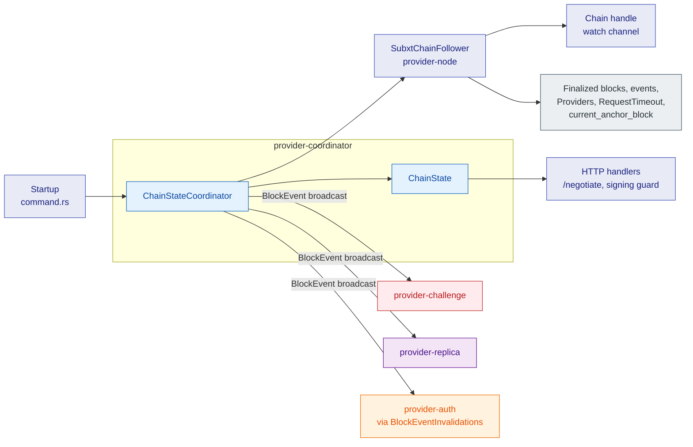
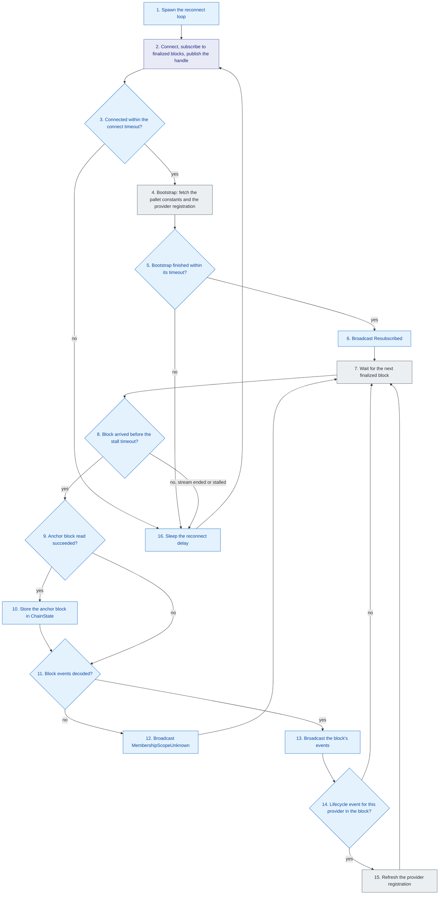

# provider-coordinator

## 1. Overview

`provider-coordinator` keeps the provider node's view of the chain current.
It owns the node's chain connection, follows finalized blocks, writes the shared `ChainState` that request handlers read, and fans out the decoded block events that the other background services react to.
This document is for engineers who change how the node connects to the chain, how it tracks its own registration, or how chain events reach the rest of the node.

## 2. Position in the node

Callers: `storage-provider-node` constructs and starts the coordinator at startup.

Callees: a `ChainFollower`, which the node implements as `SubxtChainFollower`.
Each connection it opens exposes a `FinalizedBlocks` stream and a `ChainStateChainClient` for reads.

Consumers of its output: HTTP handlers read `ChainState` (anchor block, pallet constants, provider registration); `provider-challenge`, `provider-replica` and the auth invalidation feed subscribe to the `BlockEvent` broadcast defined in `provider-events`.

External interfaces: the finalized block subscription, block events, `Providers` storage, the `RequestTimeout` constant and the `current_anchor_block` runtime API.
No extrinsics, no HTTP endpoints, no local DB.

## 3. How It Works

## 4. Explain

1. **Spawn the reconnect loop.**
   Input: the `ChainFollower`, the provider account, the shared `ChainState` and the broadcast sender.
   Output: a `ChainStateCoordinatorHandle` that keeps the task alive.
   Implemented by [`ChainStateCoordinator::start`](../../../crates/providers/coordinator/src/lib.rs) and the private `run`.

2. **Connect, subscribe to finalized blocks, publish the handle.**
   Input: the configured transport.
   Output: a `ChainConnection` containing a `FinalizedBlocks` stream and a `ChainStateChainClient` on the same connection.
   The follower publishes the new handle to the watch channel only after the subscription succeeds, so no consumer sees a dead connection.
   Implemented by [`ChainFollower::connect`](../../../crates/providers/coordinator/src/chain.rs) and the node's [`SubxtChainFollower`](../../../provider-node/src/chain_follower.rs).

3. **Connected within the connect timeout?**
   Input: the result of step 2 and the connect timeout.
   Output: yes continues with the bootstrap; no, on a connection error or a timeout, continues with the reconnect delay.
   The timeout exists because the light transport has no timeout of its own.
   Implemented by the private `ChainStateCoordinator::connect_and_follow` and `with_timeout` in [`lib.rs`](../../../crates/providers/coordinator/src/lib.rs).

4. **Bootstrap: fetch the pallet constants and the provider registration.**
   Input: the read client.
   Output: `sync_constants` writes `ChainState::constants` from the `RequestTimeout` constant, and `refresh_provider_state` writes `ChainState::provider_info` from the `Providers` entry for this account, or clears it when the provider is not registered.
   Implemented by [`sync_constants`](../../../crates/providers/coordinator/src/lib.rs) and [`refresh_provider_state`](../../../crates/providers/coordinator/src/lib.rs) over [`ChainStateChainClient`](../../../crates/providers/coordinator/src/chain.rs).

5. **Bootstrap finished within its timeout?**
   Input: the bootstrap future and the bootstrap timeout.
   Output: yes continues; no continues with the reconnect delay, so a wedged backend cannot hang the loop.
   Implemented by the private `ChainStateCoordinator::follow` and `with_timeout`.

6. **Broadcast Resubscribed.**
   Input: the current anchor block.
   Output: a `BlockEvent::Resubscribed` on the broadcast channel.
   Every subscriber treats it as a signal that it may have missed events and runs its own full scan.
   Implemented by `follow`.

7. **Wait for the next finalized block.**
   Input: the stream.
   Output: a `FinalizedBlock` with the block number, the optional anchor block read through the `current_anchor_block` runtime API at that block, and optional `BlockContents` containing the coordinator-relevant `BlockEvent`s plus the provider accounts of the block's provider-lifecycle events.
   Implemented by [`FinalizedBlocks::next`](../../../crates/providers/coordinator/src/chain.rs); the node decodes events in [`decode_block_contents`](../../../provider-node/src/event_decoding.rs).

8. **Block arrived before the stall timeout?**
   Input: the stream result and the stall timeout.
   Output: yes continues with the block; no, when the stream ended or no block arrived in time, leaves the follow loop and continues with the reconnect delay.
   Implemented by `follow`.

9. **Anchor block read succeeded?**
   Input: the optional anchor block in the `FinalizedBlock`.
   Output: yes stores the value; no keeps the previous value and continues with the events.
   Implemented by `follow`.

10. **Store the anchor block in ChainState.**
    Input: the block's anchor block.
    Output: `ChainState::current_anchor_block` updated.
    Implemented by `follow` writing [`ChainState`](../../../crates/providers/coordinator/src/lib.rs).

11. **Block events decoded?**
    Input: the optional `BlockContents`.
    Output: yes continues with the broadcast; no continues with the scope-unknown escalation, because the block's membership changes are unknown.
    Implemented by `follow`.

12. **Broadcast MembershipScopeUnknown.**
    Input: the block number.
    Output: a `BlockEvent::MembershipScopeUnknown` on the broadcast channel, after which the loop waits for the next block.
    The auth membership cache drops every entry on this event.
    Implemented by the private `escalate_block_read_failure` in [`lib.rs`](../../../crates/providers/coordinator/src/lib.rs).

13. **Broadcast the block's events.**
    Input: the decoded `BlockEvent`s.
    Output: each event sent on the broadcast channel in block order.
    `follow` ignores send failures, which mean no subscriber exists.
    Implemented by `follow` using [`BlockEventTx`](../../../crates/providers/events/src/lib.rs).

14. **Lifecycle event for this provider in the block?**
    Input: the block's lifecycle accounts and the provider account.
    Output: yes continues with the refresh; no waits for the next block.
    Several events in one block collapse to one refresh, which is correct because the refresh always reads the latest state.
    Implemented by [`refresh_if_relevant_event`](../../../crates/providers/coordinator/src/lib.rs).

15. **Refresh the provider registration.**
    Input: the read client and the provider account.
    Output: `ChainState::provider_info` re-read in full, after which the loop waits for the next block.
    Implemented by [`refresh_provider_state`](../../../crates/providers/coordinator/src/lib.rs).

16. **Sleep the reconnect delay.**
    Input: the failure or stream end from step 3, 5 or 8.
    Output: after the fixed delay the loop connects again.
    Implemented by the private `run`.

## 5. Failure handling

| Error case | Action |
| --- | --- |
| Connect fails or exceeds the connect timeout | Log, sleep the reconnect delay, retry. The previous handle stays published until a new one replaces it. |
| Bootstrap reads exceed the bootstrap timeout | Drop the connection and reconnect. |
| No finalized block within the stall timeout | Drop the connection and reconnect. |
| Stream ends or yields an error | Reconnect after the delay. |
| Anchor block read fails for one block | Keep the previous value and continue. |
| Block handle or events cannot be read | Broadcast `MembershipScopeUnknown` so the auth cache distrusts every entry, then continue with the next block. |
| A membership event fails to decode | The node's decoder escalates to `MembershipScopeUnknown` for the same reason. Other undecodable events are logged and skipped; the subscribers' safety-net scans cover them. |
| `RequestTimeout` constant absent from metadata | Log a warning and leave `constants` unset; `/negotiate` answers `503` until a reconnect finds it. |
| Provider registration read fails | Log a warning and keep the previous value. |
| Provider not registered | Set `provider_info` to none; signing endpoints answer `503` until registration lands. |

After a crash or restart: `ChainState` and the connection exist only in memory and start empty.
The first connect runs the bootstrap again, so a registered provider sees its registration without waiting for an event.
Nothing is written on chain or on disk by this crate.

## 6. References

- Node-side follower and decoder: [`provider-node/src/chain_follower.rs`](../../../provider-node/src/chain_follower.rs) and [`provider-node/src/event_decoding.rs`](../../../provider-node/src/event_decoding.rs).
- Design: [The anchor clock](../scalable-web3-storage-implementation.md#the-anchor-clock-block-number-denomination), [Events](../scalable-web3-storage-implementation.md#events) and [Runtime API](../scalable-web3-storage-implementation.md#runtime-api) in the implementation design.
