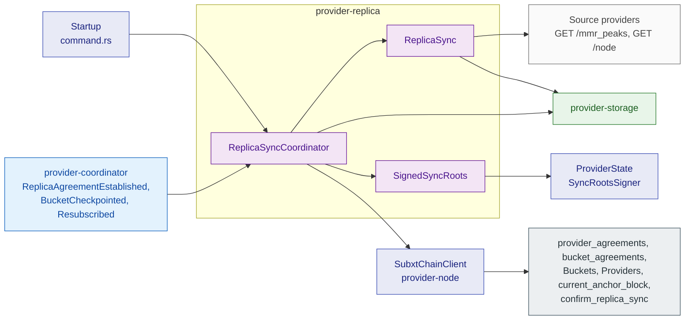
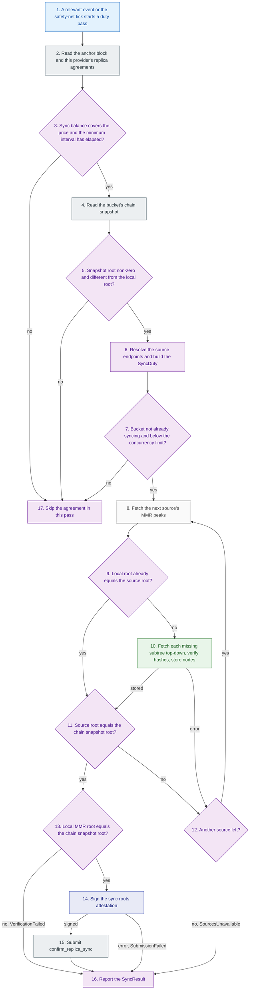

# provider-replica

## 1. Overview

`provider-replica` makes a provider act as a replica: it pulls a bucket's committed data from the bucket's primaries or other replicas and confirms the sync on chain to collect the per-sync payment.
It contains the HTTP pull protocol and the background coordinator that discovers replica duties from chain events.
This document is for engineers who change how replica duties are found, how data is fetched and verified, or how a sync is confirmed.

## 2. Position in the node

Callers: `storage-provider-node` starts the coordinator at startup when `--enable-replica-sync` is set and a signing chain client exists.
`provider-coordinator` feeds it `BlockEvent`s through the `provider-events` broadcast channel.

Callees: `provider-storage` for the local bucket and nodes, a `ReplicaSyncChainClient` for chain access, a `SyncRootsSigner` for the attestation, and the HTTP API of other provider nodes.
The node supplies `SubxtChainClient` and `ProviderState` as the signer.

External interfaces: the `provider_agreements` and `bucket_agreements` runtime APIs, the `Buckets` and `Providers` storage, the `current_anchor_block` runtime API, and the `confirm_replica_sync` extrinsic.
As an HTTP client it calls `GET /mmr_peaks` and `GET /node` on source providers.
The endpoints this node serves to other replicas exist in `storage-provider-node`.
The local DB is reached through `provider-storage`.

## 3. How It Works

Steps 3 to 6 run for every agreement before step 7 starts.
Steps 7 to 16 run per duty, one duty at a time.

## 4. Explain

1. **A relevant event or the safety-net tick starts a duty pass.**
   Input: a `BlockEvent::ReplicaAgreementEstablished` for this provider, a `BlockEvent::BucketCheckpointed` for a bucket in local storage, a `Resubscribed` event, a lagged channel, or the interval tick.
   Output: one call to the duty pass.
   The pass first removes finished sync tasks from its active set.
   The loop runs only with `auto_confirm` enabled, which the node always sets; with it disabled the loop drops every trigger and a direct sync reports `Success` without submitting.
   A `ForceSync` command builds a duty with an unlimited balance and no interval, skips the active-set check and starts at the step 7 re-checks.
   Implemented by the private `ReplicaSyncCoordinator::run_loop` and `run_duty_pass` in [`coordinator.rs`](../../../crates/providers/replica/src/coordinator.rs), started by [`ReplicaSyncCoordinator::start`](../../../crates/providers/replica/src/coordinator.rs).

2. **Read the anchor block and this provider's replica agreements.**
   Input: the provider id and the ids of every bucket in local storage.
   Output: a `ReplicaAgreementInfo` per replica agreement whose bucket exists locally, with sync balance, sync price, minimum sync interval and last sync.
   A failed read ends the pass with a warning.
   Implemented by [`ReplicaSyncCoordinator::get_active_replica_duties`](../../../crates/providers/replica/src/coordinator.rs) over [`ReplicaSyncChainClient::get_current_block`](../../../crates/providers/replica/src/coordinator.rs) and [`ReplicaSyncChainClient::fetch_replica_agreements`](../../../crates/providers/replica/src/coordinator.rs), which the node backs with the `provider_agreements` runtime API.

3. **Sync balance covers the price and the minimum interval has elapsed?**
   Input: one agreement and the anchor block.
   Output: no skips the agreement; yes continues with the snapshot read.
   The interval check compares the anchor block with the block of the last sync and does not run when no sync has happened.
   Implemented by the private `duty_for` in [`coordinator.rs`](../../../crates/providers/replica/src/coordinator.rs).

4. **Read the bucket's chain snapshot.**
   Input: the bucket id.
   Output: the on-chain MMR root and leaf count of the bucket.
   A failed read skips the agreement with a warning; the next pass retries it.
   Implemented by [`ReplicaSyncChainClient::fetch_bucket_snapshot`](../../../crates/providers/replica/src/coordinator.rs).

5. **Snapshot root non-zero and different from the local root?**
   Input: the snapshot and the local bucket row, if any.
   Output: no skips the agreement, because the bucket is empty on chain or already synced; yes continues.
   Implemented by `duty_for` over [`StorageBackend::get_bucket`](../../../crates/providers/storage/src/backend/mod.rs).

6. **Resolve the source endpoints and build the SyncDuty.**
   Input: the bucket id, the agreement and the snapshot.
   Output: a `SyncDuty` with the target root, the target leaf count and the source endpoints.
   Sources are the bucket's primaries first, then its other replicas, resolved to HTTP endpoints from their registered multiaddrs; a failed replica listing shrinks the set to primaries only.
   Implemented by the private `fetch_source_endpoints` over [`ReplicaSyncChainClient::fetch_primary_endpoints`](../../../crates/providers/replica/src/coordinator.rs) and [`ReplicaSyncChainClient::fetch_replica_endpoints`](../../../crates/providers/replica/src/coordinator.rs).

7. **Bucket not already syncing and below the concurrency limit?**
   Input: the active sync set and `max_concurrent_syncs`.
   Output: the pass skips a duty for a bucket already syncing, the concurrency limit ends the pass for the remaining duties, and yes starts the sync.
   No code inserts into the active set today, so both checks always pass and the duties run one at a time.
   The sync then re-checks the step 3 and 5 conditions against the duty and reports `AlreadySynced`, `InsufficientBalance` or `NoDataToSync` when one no longer applies.
   Implemented by `run_duty_pass` and [`ReplicaSyncCoordinator::sync_and_confirm`](../../../crates/providers/replica/src/coordinator.rs).

8. **Fetch the next source's MMR peaks.**
   Input: the bucket id and one source endpoint, taken in order.
   Output: the source's current MMR root and peak hashes.
   `sync_from_source` creates the local bucket row with an unbounded quota if it does not exist.
   A transport error, a non-success status or an undecodable response counts as a failed source.
   Implemented by [`ReplicaSync::sync_from_source`](../../../crates/providers/replica/src/sync.rs) calling `GET /mmr_peaks`.

9. **Local root already equals the source root?**
   Input: the local bucket row and the source root.
   Output: yes skips the fetch and returns the source root; no continues with the subtree fetch.
   Implemented by `sync_from_source`.

10. **Fetch each missing subtree top-down, verify hashes, store nodes.**
    Input: each peak hash.
    Output: every node under the peak present in local storage, or an error that counts as a failed source.
    The fetch skips a node already present, together with its subtree.
    The fetch rebuilds each node from the wire shape, hashes it, and rejects it on a hash mismatch before following its children.
    The fetch stores the children before the parent, because `store_node` requires them to be present.
    Implemented by the private `ReplicaSync::fetch_subtree` calling `GET /node`, and [`StorageBackend::store_node`](../../../crates/providers/storage/src/backend/mod.rs).

11. **Source root equals the chain snapshot root?**
    Input: the root returned by step 8 or 9 and the duty's target root.
    Output: yes accepts this source; no counts the source as failed, because it serves a different state than the chain snapshot.
    Implemented by `sync_and_confirm`.

12. **Another source left?**
    Input: the remaining source endpoints.
    Output: yes continues with the next source; no reports `SourcesUnavailable` with the tried endpoints.
    Implemented by `sync_and_confirm`.

13. **Local MMR root equals the chain snapshot root?**
    Input: the local bucket after the fetch and the duty's target root.
    Output: yes accepts the sync and continues with the attestation; no reports `VerificationFailed`.
    Implemented by `sync_and_confirm`.
    Known gap: the current `ReplicaSync` stores the fetched nodes but does not commit the fetched leaves to the local MMR, so the local root does not advance and this step fails today; a test in the crate pins that behaviour.
    This deviates from the Replica Sync section of the implementation design and needs a tracking issue.

14. **Sign the sync roots attestation.**
    Input: the target root.
    Output: a `SignedSyncRoots` containing the seven-slot roots array with the target in position 0 and a scheme-tagged signature over its SCALE encoding.
    The signer rejects the request when no key is configured, the registration is not published yet, or the key differs from the registration; the sync then reports `SubmissionFailed`.
    Implemented by [`SignedSyncRoots::sign`](../../../crates/providers/replica/src/sync_roots.rs) over [`SyncRootsSigner`](../../../crates/providers/replica/src/sync_roots.rs), which [`ProviderState`](../../../provider-node/src/lib.rs) implements.

15. **Submit confirm_replica_sync.**
    Input: the bucket id and the attestation.
    Output: the finalized extrinsic.
    The node's client returns position 0 and a zero payment; the client does not read the matched position and the payment back from events yet.
    Implemented by [`ReplicaSyncCoordinator::confirm_on_chain`](../../../crates/providers/replica/src/coordinator.rs) and [`ReplicaSyncChainClient::submit_sync_confirmation`](../../../crates/providers/replica/src/coordinator.rs).

16. **Report the SyncResult.**
    Input: the outcome of steps 7 to 15.
    Output: a `SyncResult` passed to the optional callback and logged.
    Implemented by [`SyncResult`](../../../crates/providers/replica/src/coordinator.rs).

17. **Skip the agreement in this pass.**
    Input: the failed condition from step 3, 5 or 7.
    Output: no sync for this bucket until the next pass.
    Implemented by `duty_for` returning no duty and by `run_duty_pass`.

## 5. Failure handling

| Error case | Action |
| --- | --- |
| Agreement list or anchor block read fails | Log a warning; the next duty pass retries. |
| Snapshot, endpoint or local bucket read fails for one bucket | Skip that bucket in this pass; the next pass retries. |
| Replica endpoint list fails | Continue with primaries only. |
| Balance below price, interval not elapsed, empty snapshot, already synced | Skip the bucket; no chain write. |
| Source request fails at transport level, or answers a non-success status such as `401` from a private bucket's primary | Try the next source. |
| A fetched node hashes to a different value than requested | Stop this source without storing the node; try the next source. |
| Every source fails | Report `SourcesUnavailable`; the next pass retries. |
| Local root differs from the target after the fetch | Report `VerificationFailed`; no confirmation is submitted. |
| Local bucket read fails before or after the fetch | Report `StorageFailed`. |
| Storage write fails during the fetch | Treated like a source failure: try the next source, then report `SourcesUnavailable`. |
| No signer, or signing rejected | Report `SubmissionFailed`; no extrinsic is sent. |
| Extrinsic rejected or the watch dies | Report `SubmissionFailed`; the next pass retries, and a duplicate rejection on retry proves the earlier attempt landed. |
| Event channel lagged | Run a duty pass. |
| Coordinator paused | Events stay queued and are replayed on resume. |

After a crash or restart: every node stored before the crash remains in the local DB, so a repeated sync skips it and fetches only what is missing.
The replica bucket row remains with its unbounded quota.
The coordinator keeps no duty list; the first interval tick or `Resubscribed` event rebuilds it from chain.
On chain, an unconfirmed sync leaves the agreement's `last_sync` unchanged and the sync balance untouched.

## 6. References

- Node-side chain client and signer: [`provider-node/src/subxt_client.rs`](../../../provider-node/src/subxt_client.rs) and [`provider-node/src/lib.rs`](../../../provider-node/src/lib.rs).
- Design: [Replica Sync API](../scalable-web3-storage-implementation.md#replica-sync-api) and [Replica Sync Status](../scalable-web3-storage-implementation.md#replica-sync-status) in the implementation design; [No on-chain gate on replica creation](../scalable-web3-storage.md#no-on-chain-gate-on-replica-creation) in the main design.
