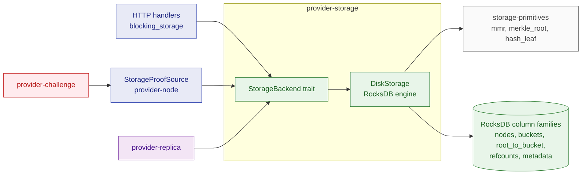
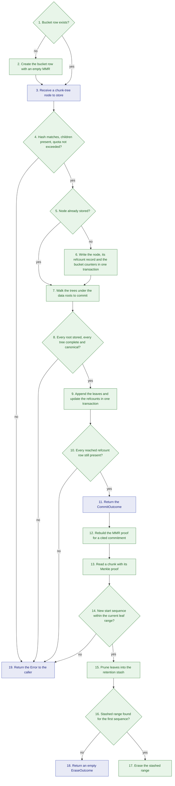

# provider-storage

## 1. Overview

`provider-storage` is the provider node's persistence layer.
It stores content-addressed chunk-tree nodes, keeps one Merkle Mountain Range (MMR) per bucket over the committed data roots, and produces the MMR and chunk proofs the node signs and submits.
This document is for engineers who change what the node persists, how commits and deletions update the bucket MMR, or how proofs are rebuilt from stored state.

## 2. Position in the node

Callers: every HTTP handler in `storage-provider-node` through `ProviderState::blocking_storage`; `provider-replica` for the local bucket and nodes; `provider-challenge` through the node's `StorageProofSource` adapter.

Callees: `storage-primitives` for hashing, the canonical Merkle tree and the MMR, and the `rocksdb` engine.

External interfaces: the local RocksDB directory given by `--storage-path`.
No chain access and no HTTP.

## 3. How It Works

The main workflow is the life of one data root: upload, commit, prove, prune, erase.
Steps 3 to 6 repeat for every node of the upload.

## 4. Explain

1. **Bucket row exists?**
   Input: bucket id and byte quota.
   Output: yes leaves the row unchanged; no continues with the creation.
   Implemented by [`StorageBackend::init_bucket`](../../../crates/providers/storage/src/backend/mod.rs) on [`DiskStorage`](../../../crates/providers/storage/src/backend/rocksdb.rs).

2. **Create the bucket row with an empty MMR.**
   Input: bucket id and byte quota.
   Output: a `BucketState` row with no leaves, a zero root and the quota.
   Implemented by `init_bucket`.

3. **Receive a chunk-tree node to store.**
   Input: bucket id, the hash the caller claims, and a `ChunkTreeNode` that is either a chunk or two child hashes.
   Output: validation starts.
   Implemented by [`StorageBackend::store_node`](../../../crates/providers/storage/src/backend/mod.rs) and [`ChunkTreeNode`](../../../crates/providers/storage/src/backend/types.rs).

4. **Hash matches, children present, quota not exceeded?**
   Input: the node, the claimed hash and the bucket row.
   Output: no rejects with `InvalidHash`, `ChildrenMissing`, `BucketNotFound` or `QuotaExceeded`; yes continues.
   `store_node` recomputes the node's hash, which must equal the claimed one, and requires an internal node's children to exist; these two checks run before the transaction.
   The quota check runs inside a pessimistic transaction that locks the bucket row: the node's size added to the used bytes must not exceed the quota.
   Implemented by `store_node`.

5. **Node already stored?**
   Input: the node column family and the hash.
   Output: yes writes nothing and charges nothing; no continues with the write.
   Implemented by `store_node`.

6. **Write the node, its refcount record and the bucket counters in one transaction.**
   Input: the validated node.
   Output: the node written under its hash, a refcount record with count zero charging the bucket, and the bucket's used bytes and node count updated.
   Implemented by `store_node`.

7. **Walk the trees under the data roots to commit.**
   Input: the data roots to commit.
   Output: a `CommitWalk` with the data size of each root and the number of times the walk reaches each node.
   The walk runs outside the transaction and a visit budget bounds it.
   Implemented by the private `DiskStorage::walk_commit_roots`, [`StorageBackend::walk_tree`](../../../crates/providers/storage/src/backend/mod.rs) and the private `canonical_size`.

8. **Every root stored, every tree complete and canonical?**
   Input: the walk result.
   Output: no rejects with `RootNotFound`, `NodeNotFound` or `NonCanonicalTree`; yes continues.
   A canonical tree is the Merkle tree over fixed-size chunks with only the last chunk shorter.
   Implemented by `walk_commit_roots` and `canonical_size`.

9. **Append the leaves and update the refcounts in one transaction.**
   Input: the `CommitWalk` and the bucket id.
   Output: one `MmrLeaf` per root appended to the bucket's leaves, the MMR root recomputed, and each reached node's refcount increased.
   Implemented by the private `DiskStorage::apply_commit` using `mmr::root` from `storage-primitives`.

10. **Every reached refcount row still present?**
    Input: the refcount rows read inside the transaction.
    Output: no rejects the commit, because an erase deleted the node since the walk and the caller must re-upload; yes continues.
    Implemented by `apply_commit`.

11. **Return the CommitOutcome.**
    Input: the bucket state after the commit.
    Output: a `CommitOutcome` with the MMR root, the start sequence, the leaf count and the index of each new leaf, all from the same bucket state so they are consistent.
    The node signs this as the commitment.
    Implemented by [`StorageBackend::commit`](../../../crates/providers/storage/src/backend/mod.rs) and [`CommitOutcome`](../../../crates/providers/storage/src/backend/mod.rs).

12. **Rebuild the MMR proof for a cited commitment.**
    Input: bucket id, a `Commitment` (root, start sequence, leaf count) and a leaf index relative to that start sequence.
    Output: an `MmrProof` whose root equals the cited root.
    `get_mmr_proof_for_commitment` assembles the leaf history from the stashed ranges followed by the live leaves, cuts the cited window from it, and builds the proof over that window.
    Implemented by [`StorageBackend::get_mmr_proof_for_commitment`](../../../crates/providers/storage/src/backend/mod.rs).

13. **Read a chunk with its Merkle proof.**
    Input: a data root and a chunk index.
    Output: the chunk bytes and the sibling hashes up to the data root.
    `get_chunk_at_index` derives the chunk count from the nodes down the right edge of the tree, and the tree shape follows from that count.
    Implemented by [`StorageBackend::get_chunk_at_index`](../../../crates/providers/storage/src/backend/mod.rs) and, for byte ranges, [`StorageBackend::get_chunks_in_range`](../../../crates/providers/storage/src/backend/mod.rs).

14. **New start sequence within the current leaf range?**
    Input: bucket id and the new start sequence.
    Output: no rejects with `InvalidStartSeq`, because the sequence would rewind the bucket or overshoot its last leaf; yes continues.
    A new start sequence equal to the current one changes nothing.
    Implemented by [`StorageBackend::delete_before`](../../../crates/providers/storage/src/backend/mod.rs).

15. **Prune leaves into the retention stash.**
    Input: the validated start sequence.
    Output: the leaves before the new start sequence moved into a `PrunedRange`, the start sequence advanced, the MMR root recomputed, and the post-prune `Commitment` returned for the node to sign.
    The bytes stay on disk so challenges against older commitments remain provable.
    Implemented by `delete_before` and [`PrunedRange`](../../../crates/providers/storage/src/backend/types.rs).

16. **Stashed range found for the first sequence?**
    Input: bucket id and the first sequence of a stashed range.
    Output: yes continues with the erase; no returns an empty outcome.
    The backend does not check the deletion receipt: attaching the admin's `DeletionReceipt` and checking that liability has passed is the caller's job, and no node endpoint calls the erase yet.
    Implemented by [`StorageBackend::erase_pruned_range`](../../../crates/providers/storage/src/backend/mod.rs); the caller stores the receipt with [`StorageBackend::attach_deletion_receipt`](../../../crates/providers/storage/src/backend/mod.rs).

17. **Erase the stashed range.**
    Input: the `PrunedRange`.
    Output: the refcount of each node under the range's leaves decreased, zero-refcount nodes deleted, the charged bytes credited back, and the range dropped, in one transaction.
    The erase keeps the receipt as the evidence for the on-chain deletion defense.
    Implemented by `erase_pruned_range` and [`DeletionReceipt`](../../../crates/providers/storage/src/backend/types.rs).

18. **Return an empty EraseOutcome.**
    Input: the missing range.
    Output: an `EraseOutcome` with zero deleted nodes and zero credited bytes, so a repeated erase is harmless.
    Implemented by `erase_pruned_range` and [`EraseOutcome`](../../../crates/providers/storage/src/backend/mod.rs).

19. **Return the Error to the caller.**
    Input: the failed check from step 4, 8, 10 or 14.
    Output: a `provider_storage::Error`; the variants and the caller's action are in section 5.
    Implemented by [`Error`](../../../crates/providers/storage/src/error.rs).

## 5. Failure handling

| Error case | Action |
| --- | --- |
| Database directory has data but no format version, or a different version | Refuse to open with `IncompatibleFormat`; the node aborts startup. |
| Expected column family missing | Refuse with `ColumnFamilyMissing`. |
| Claimed hash differs from the node's hash | Reject with `InvalidHash`; nothing is written. |
| Internal node's children not stored | Reject with `ChildrenMissing`; the caller uploads bottom-up. |
| Node has both data and children, or neither, or the wrong child count | Reject with `InvalidNode` or `InvalidChildCount`. |
| Chunk larger than the chunk size | Reject with `ChunkTooLarge`. |
| Quota exceeded | Reject with `QuotaExceeded`; nothing is written. |
| Bucket unknown | Reject with `BucketNotFound`. |
| Data root not stored, or a node under it missing | Reject the commit with `RootNotFound` or `NodeNotFound`; the MMR is unchanged. |
| Tree not canonical, or too many nodes to walk | Reject with `NonCanonicalTree` or `TreeTooLarge`. |
| Another writer keeps the bucket row locked past the lock timeout, or a deadlock is detected | Reject with `BucketBusy`; the caller retries. |
| Refcount row gone between walk and transaction | Reject the commit with `NodeNotFound`; the caller re-uploads. |
| Cited commitment window outside the stored history | Reject with `LeavesNotHeld`. |
| Rebuilt root differs from the cited root | Reject with `CommitmentNotReproducible`. |
| Chunk index past the tree's chunk count | Reject with `ChunkIndexOutOfRange`. |
| New start sequence rewinds or overshoots | Reject with `InvalidStartSeq`. |
| Engine read or write error, or a record that does not decode | Return `RocksDb` or `Serialization`; the node answers `500`. |

After a crash or restart: every read-modify-write path runs in one transaction, so a bucket row is either in its previous state or in the new one.
Nodes stored before a commit remain on disk, charged to the bucket, with a refcount of zero until a commit references them.
Pruned ranges remain in the stash until erased, and deletion receipts remain after erasure.
The format version recorded in the metadata column family is checked on every open.
Nothing is written on chain by this crate.

## 6. References

- Design: [Content-Addressed Storage](../scalable-web3-storage-implementation.md#content-addressed-storage), [Commit](../scalable-web3-storage-implementation.md#commit), [Chunk Tree](../scalable-web3-storage-implementation.md#chunk-tree), [MMR Leaf](../scalable-web3-storage-implementation.md#mmr-leaf) and [MMR Proof](../scalable-web3-storage-implementation.md#mmr-proof) in the implementation design; [Data Model](../scalable-web3-storage.md#data-model) in the main design.
