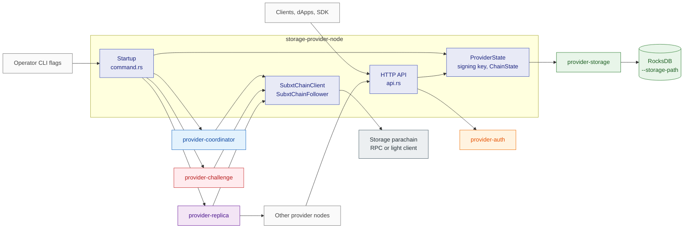
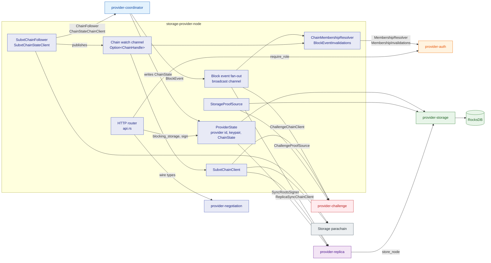

# storage-provider-node

## 1. Overview

`storage-provider-node` is the executable a storage provider operates.
It wires the provider crates into one process: an HTTP API for clients and other providers, one chain connection shared by every component, the provider's signing key, and the background coordinators that react to chain events.
This document is for engineers who need to understand what the binary itself owns, how it connects the `provider-*` crates to each other, and how it degrades when a part is missing or unreachable.

## 2. Position in the node

The binary is the composition root.
It has no callers inside the node; the operator starts it, and clients, dApps and other provider nodes call its HTTP API.

Callers: the operator (CLI flags and environment), clients and the SDK (HTTP), other provider nodes (`/mmr_peaks` and `/node` during replica sync).

Callees: `provider-auth` (request authentication), `provider-storage` (local data), `provider-coordinator` (chain state and block events), `provider-challenge` (challenge responses), `provider-replica` (replica sync), `provider-negotiation` (signed agreement terms), `provider-events` (block event fan-out), `storage-subxt` (generated chain bindings).

External interfaces:

- Chain reads: `Providers`, `Buckets`, `StorageAgreements` and `Challenges` storage, the `RequestTimeout` constant, the `StorageProviderApi` runtime API, and the finalized block subscription.
- Chain extrinsics: `update_provider_multiaddr`, `respond_to_challenge`, `confirm_replica_sync`.
- HTTP endpoints: `/health`, `/info`, `/stats`, `/node`, `/exists`, `/commit`, `/read`, `/commitment`, `/checkpoint-signature`, `/mmr_proof`, `/chunk_proof`, `/delete`, `/mmr_peaks`, `/fetch_nodes`, `/negotiate`, `/replica/historical_roots`, `/replica/sync_status`.
- Local DB: the RocksDB directory given by `--storage-path`, opened through `provider-storage`.

## 3. Composition

The binary is a composition root: it implements the traits the crates require, builds four shared objects, and starts the crates.
The crates share no runtime state except through the four shared objects; the one direct call between crates is `provider-replica` writing fetched nodes to the storage backend.

### Shared objects

- **Chain watch channel.**
  A `tokio::sync::watch` channel of `Option<ChainHandle>`, created in `command.rs`.
  `chain_connection::connect` fills it at startup when the chain is reachable; `SubxtChainFollower` republishes a new handle after every reconnect, only once its block subscription succeeds.
  `SubxtChainClient` and `ChainMembershipResolver` read the latest handle on every call, so a reconnect needs no restart.
  Defined in [`chain_connection.rs`](../../../provider-node/src/chain_connection.rs).

- **Block event fan-out.**
  A `tokio::sync::broadcast` channel of `BlockEvent` with the capacity from `provider-events`.
  The chain-state coordinator is the only sender.
  The auth invalidation feed, the replica sync coordinator and the challenge responder subscribe before the follower starts, so none of them misses the first `Resubscribed` event.
  Defined in [`command.rs`](../../../provider-node/src/command.rs) over [`provider-events`](../../../crates/providers/events/src/lib.rs).

- **`ProviderState`.**
  The object every HTTP handler receives: the provider id, the optional signing keypair whose scheme `--key-scheme` selects, the `ChainState` the coordinator writes, the storage backend and the authenticator.
  `sign` rejects every signing request until the coordinator has published a registration whose public key matches the local key.
  `blocking_storage` runs storage work on the blocking thread pool so RocksDB I/O never stalls an async worker.
  Defined in [`lib.rs`](../../../provider-node/src/lib.rs).

- **Storage backend.**
  One `Arc<dyn StorageBackend>` that `command.rs` opens from `--storage-backend` and `--storage-path`; the HTTP handlers, `StorageProofSource` and the replica sync share it.
  Defined in [`provider-storage`](../../../crates/providers/storage/src/backend/mod.rs).

### Crate wiring

| Crate | The node supplies | The node consumes | Document |
| --- | --- | --- | --- |
| `provider-auth` | [`ChainMembershipResolver`](../../../provider-node/src/membership.rs) implementing `MembershipResolver` (reads `Buckets` and `StorageAgreements` through the chain watch channel), [`BlockEventInvalidations`](../../../provider-node/src/membership.rs) implementing `MembershipInvalidations` (a fan-out subscription), the provider account for operator self-auth, the `--auth-*` settings | `Authenticator::require_role`, which `check_role` calls in every bucket-bound handler | [provider-auth](provider-auth.md) |
| `provider-storage` | The backend spec from `--storage-backend` and `--storage-path` | `StorageBackend` behind `ProviderState::blocking_storage`; every data endpoint | [provider-storage](provider-storage.md) |
| `provider-coordinator` | [`SubxtChainFollower`](../../../provider-node/src/chain_follower.rs) implementing `ChainFollower`, [`SubxtChainStateClient`](../../../provider-node/src/chain_follower.rs) implementing `ChainStateChainClient`, [`decode_block_contents`](../../../provider-node/src/event_decoding.rs) for the block events, the provider account, the `ChainState` and the fan-out sender | `ChainState`: the anchor block, the provider registration and the pallet constants, which the signing guard and `/negotiate` read | [provider-coordinator](provider-coordinator.md) |
| `provider-events` | The broadcast channel and its subscriptions | `BlockEvent`, `BlockEventTx`, `BlockEventRx` | covered in [provider-coordinator](provider-coordinator.md) |
| `provider-challenge` | [`SubxtChainClient`](../../../provider-node/src/subxt_client.rs) implementing `ChallengeChainClient`, [`StorageProofSource`](../../../provider-node/src/challenge_proofs.rs) implementing `ChallengeProofSource`, the provider account, the `--challenge-*` settings, a fan-out subscription | The `ChallengeResponder` task handle | [provider-challenge](provider-challenge.md) |
| `provider-replica` | [`SubxtChainClient`](../../../provider-node/src/subxt_client.rs) implementing `ReplicaSyncChainClient`, [`ProviderState`](../../../provider-node/src/lib.rs) implementing `SyncRootsSigner`, the provider id, the storage backend, the `--replica-*` settings, a fan-out subscription; the endpoints `/mmr_peaks` and `/node` that other nodes sync from, and the `/replica/*` status endpoints for clients | The `ReplicaSyncCoordinator` task handle | [provider-replica](provider-replica.md) |
| `provider-negotiation` | Request validation against the registration, terms built from the chain-read price and the anchor block, the signature from the provider keypair, in [`negotiate.rs`](../../../provider-node/src/negotiate.rs) | `NegotiateRequest`, `AgreementTermsOf` and `SignedTerms`, the wire types shared with the SDK | [Other Endpoints](../scalable-web3-storage-implementation.md#other-endpoints) and [Agreement Nonces](../scalable-web3-storage-implementation.md#agreement-nonces) |
| `storage-subxt` | Nothing | The generated chain bindings that every subxt adapter above uses | |

No crate under `crates/providers/` depends on `subxt` or `axum`; the crates see traits and plain types.
`subxt` is confined to `chain_connection.rs`, `chain_follower.rs`, `subxt_client.rs`, `membership.rs` and `event_decoding.rs`; `axum` to `api.rs`, `error.rs` and `command.rs`.
The signing chain client exists only when `--keyfile` is set, so the challenge responder, the replica sync coordinator and the multiaddr sync need a keyfile.

## 4. Failure handling

Startup failures that abort the process:

| Error case | Action |
| --- | --- |
| Invalid CLI flags or an invalid chain transport | Abort before anything starts. |
| Storage directory cannot be opened, or its format version differs from the build | Abort. `provider-storage` rejects an incompatible database instead of reading it. |
| Unreadable keyfile, a seed that derives no account, or a keypair that cannot be built for `--key-scheme` | Abort after the chain connection attempt and the storage open. |
| Listener cannot bind | Abort. |

Degraded modes the node keeps running in:

| Condition | What is disabled | Recovery |
| --- | --- | --- |
| Chain unreachable at startup | Auth lookups and signing endpoints return `503` | The chain-state coordinator reconnects with a fixed delay and republishes the handle; no restart. |
| `--keyfile` absent | Signing endpoints return `503 signing_unavailable`; no signing chain client, so the challenge responder, the replica sync coordinator and the multiaddr sync do not start | Restart with a keyfile. |
| Provider id does not parse as an account, which is the case for the default id and implies the row above | In addition, the chain-state coordinator does not start: `ChainState` stays empty and no `BlockEvent` reaches the auth cache | Restart with a keyfile or a valid `--provider-id`. |
| Signing chain client fails to build | Same as a missing keyfile for the background services | Restart. |
| A service flag is off | That service does not start | Restart with the flag. |
| Provider not registered on chain | Signing endpoints return `503 provider_info_unavailable`; `/negotiate` returns `503 chain_state_not_ready` until the anchor block and the `RequestTimeout` constant are known, and `503 provider_deregistering` while a deregistration is pending | Clears on the coordinator's next registration refresh. |
| Local signing key differs from the registered `public_key` | Signing endpoints return `503 provider_key_mismatch` | Clears on the next registration refresh after the chain-side key changes. |

Request failures:

| Error case | Action |
| --- | --- |
| Storage call panics on the blocking pool | The request returns `500`. |
| Rate limiter error on `/negotiate` | Fail closed with `500`. A rejected token returns `429`. |
| Auth or storage error inside a handler | [`error.rs`](../../../provider-node/src/error.rs) maps it to an HTTP status: `401` for a missing or expired signature, `403` for an insufficient role, `503` for an unreachable chain, `404` for an unknown bucket or node, `400` for malformed input. The mechanism behind each error is in the crate documents linked above. |

After a crash or restart: the RocksDB directory keeps every bucket, node, MMR leaf and pruned range.
`ChainState`, the membership cache and the chain connection exist only in memory and the chain-state coordinator rebuilds them on reconnect.
The node queues no transaction on disk; the coordinators rediscover pending duties from chain state.

## 5. References

- Design: [Off-Chain: Provider Node API](../scalable-web3-storage-implementation.md#off-chain-provider-node-api) and [Provider Public Key & Signature Type](../scalable-web3-storage-implementation.md#provider-public-key--signature-type) in the implementation design; [Two Classes of Providers](../scalable-web3-storage.md#two-classes-of-providers) in the main design.
- Operator guide: [Provider Node Quick Start](../../getting-started/PROVIDER_NODE_QUICKSTART.md).
