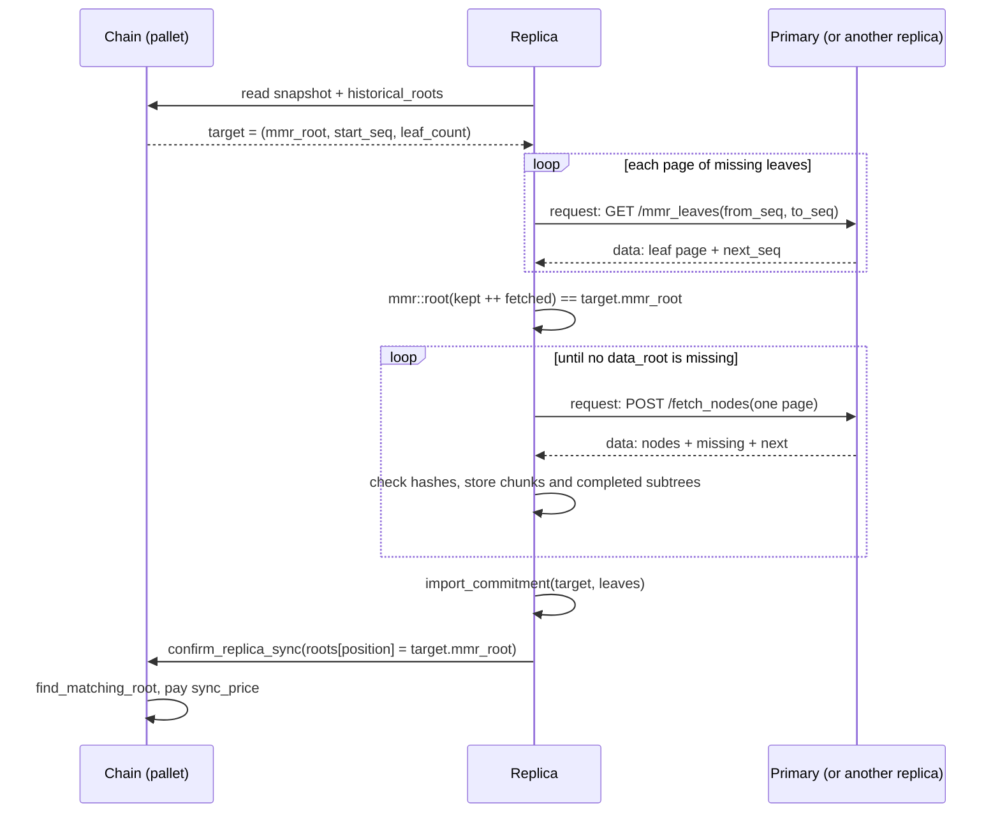
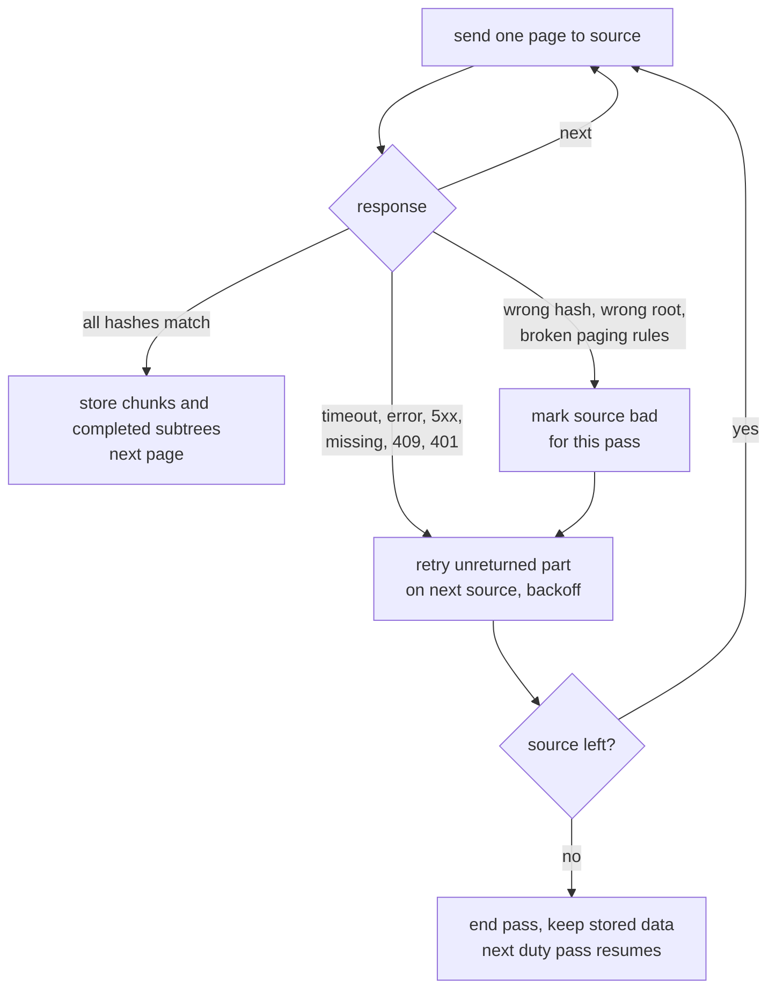

# Replica Sync Protocol

## Overview

This document specifies how a replica copies a bucket from a primary, with paged, retriable and resumable transfers.
It is a draft and is not ratified.
It replaces the MMR part of "Replica Sync API" in [the implementation doc](../design/scalable-web3-storage-implementation.md) and keeps its chunk-tree traversal.

Data moves from the primary to the replica.
A replica can also pull from another replica of the same bucket, because the replica checks every value against the chain.
Data never moves from a replica to a primary.

Code:
- `crates/providers/replica`: sync coordinator and transfer.
- `provider-node/src/api.rs`: `/mmr_leaves` (new) and `/fetch_nodes` (paged).
- `crates/providers/storage`: `import_commitment` (new).

---

## Current State

The current implementation (`crates/providers/replica/src/sync.rs`) walks the chunk trees top-down, skips nodes it already stores, checks each node's hash, and stores children before parents.
This document keeps that walk.

The following defects block the sync:

| Defect | Location | Effect |
|---|---|---|
| Peak hashes are not node keys | `sync.rs:109-111` walks `/mmr_peaks` through `GET /node` | Every fresh sync fails with 404 (#392) |
| Target root comes from the source | `sync.rs:84` | A wrong source chooses the target |
| Leaves are never installed | `sync.rs` stores nodes only | The local MMR root never matches; the post-sync check in `coordinator.rs:722-741` always fails |
| Confirm always uses position 0 | `sync_roots.rs:33-34` | A checkpoint during the sync makes `confirm_replica_sync` fail with `InvalidSyncRoot` (#420) |
| Quota is unlimited | `sync.rs:78` initializes the bucket with `u64::MAX` | The agreement's `max_bytes` is not enforced (#382) |
| No paging, timeout or concurrency limit | `/fetch_nodes` builds the whole response in memory (`provider-node/src/api.rs:571-587`); `sync_timeout` and `max_concurrent_syncs` are unused | A large bucket produces unbounded responses and blocks the coordinator |

A replica cannot rebuild the MMR leaves from the data roots.
`MmrLeaf.total_size` is cumulative, and `delete_before` keeps the old values of the remaining leaves (`crates/providers/storage/src/backend/rocksdb.rs:398-416`).
Committing the same data roots again from zero therefore gives a different root on a bucket with deleted data.
The replica must copy the exact leaf records.

---

## Sync Flow

**Sync flow overview:**

1. Replica reads the **chain** for the sync target `Commitment` `(mmr_root, start_seq, leaf_count)`.
2. Replica fetches the missing `MmrLeaf` records in pages (`GET /mmr_leaves`) and checks `mmr::root(leaves) == target.mmr_root`.
3. Replica walks the chunk trees of the missing data roots top-down and fetches missing nodes in pages (`POST /fetch_nodes`), checking each node's hash.
4. Replica installs the leaves with `import_commitment`, which checks the root again.
5. Replica confirms on-chain at the position where the chain contains the target root, and receives the per-sync payment.

**Why leaves instead of peaks?**

- The MMR exists only as the bucket's list of leaf records (`BucketState::leaves`); peak and inner hashes are not stored as nodes.
- A leaf record contains the `data_root`, so the checked leaves list exactly the uploads in the target.
- The replica checks the leaves before any chunk moves, so a source cannot make the replica fetch data outside the target.



---

## Off-Chain: Provider Node API

```
Get MMR Leaves (new, paged)
───────────────────────────
GET /mmr_leaves?bucket_id=1234&from_seq=0&to_seq=5000
Authorization: Web3Storage <...>       # Reader (anonymous on public buckets
                                       # and on buckets the serving node
                                       # holds as a replica)

Response 200:
{
  "bucket_id": 1234,
  "from_seq": 0,
  "next_seq": 2000,
  "leaves": [
    { "leaf_version": 1, "data_root": "0x..", "data_size": 1048576, "total_size": 1048576 },
    ...
  ]
}

Response 409: the node has deleted leaves below from_seq, or holds fewer
leaves than to_seq.

Note: The node returns leaves from from_seq, at most its page limit by count
and bytes. next_seq is the first seq not returned; next_seq == to_seq on the
last page. 404 means the node does not implement the endpoint, so the
replica can tell it apart from 409.
```

```
Fetch Nodes (batched, for sync, paged)
──────────────────────────────────────
POST /fetch_nodes

Capability read: keyed by hash, unauthenticated; 404 for a bucket the node
does not store (see Authentication & RBAC).

Request:
{
  "bucket_id": 1,
  "hashes": ["0xdef...", "0x456...", ...]
}

Response:
{
  "nodes": [
    { "hash": "0xdef...", "children": ["0xleft...", "0xright..."] },  // internal node
    { "hash": "0x456...", "data": "<base64>" }                        // chunk
  ],
  "missing": ["0x789..."],
  "next": ["0xabc...", ...]
}

Note: The node processes hashes in request order and stops at its page
limit by count and bytes. "missing" lists requested hashes the node does
not store. "next" lists requested hashes the node did not process because
of the limit. Every requested hash appears in exactly one of nodes,
missing or next.
```

The page limits are provider node configuration.
The replica rejects a response that breaks these rules (wrong `from_seq`, leaves past `to_seq`, a hash it did not request, or a hash in more than one list) and treats the source as bad.

On a private bucket the primaries reject `/mmr_leaves` with 401, as they reject `/mmr_peaks` today, so the replica fetches the leaves from the bucket's other replicas.
`/fetch_nodes` is a capability read, so the replica can fetch nodes from primaries on a private bucket.
A bucket that is private from creation has no source for the leaf phase, by design.

---

## Algorithm

### Target selection

The pallet stores the current snapshot and six historical slots, each a `(quotient, Commitment)` (`Bucket::historical_roots`).
At each checkpoint, slot `i` takes the new commitment when `anchor_block / prime_i` differs from its stored quotient (`crates/pallets/storage-provider/src/impls/checkpoints.rs:16-28`).
So slot `i` keeps its commitment until the first checkpoint at or after anchor block `(quotient_i + 1) * prime_i`.

The replica picks as target the entry (snapshot or slot) that the next checkpoints overwrite last:
- skip zero roots;
- skip the root of `last_sync`, because the pallet rejects it (`InvalidSyncRoot`);
- prefer the slot with the latest overwrite block `(quotient_i + 1) * prime_i`;
- use the snapshot when no slot qualifies.

The largest prime is 113 anchor blocks (about 11 minutes).
On a bucket that checkpoints often, a transfer that takes longer than the target's slot lifetime still cannot be confirmed (#420); the next pass syncs a newer target.

### Leaf phase

```
1. kept = local leaves with seq in [target.start_seq, local_end)
   (drop local leaves below target.start_seq or past the target end)
2. from = max(local_end, target.start_seq)
   to   = target.start_seq + target.leaf_count
3. Fetch GET /mmr_leaves pages from `from` until next_seq == to
   A failed page is retried on the next source from its from_seq
4. Check: mmr::root(kept ++ fetched) == target.mmr_root
5. On a mismatch: drop kept, fetch the full range from target.start_seq
   from one source. On a second mismatch: mark that source bad, next source
```

Leaf pages may come from different sources.
A mismatch in step 4 does not identify the wrong source, so step 5 uses one source for the whole range.

### Chunk phase

```
frontier = data_roots of the checked leaves not present locally, in seq order
while frontier is not empty:
    page = next page from the deepest pending tree level
    response = POST /fetch_nodes(page) to the current source
    for each node: reject if hash(node) != requested hash
    store each chunk immediately                 # chunks have no child precondition
    keep internal nodes; add their children that are not present to frontier
    store each kept internal node once both children are stored
    put "missing" and "next" hashes back in frontier
```

- A subtree that is already present is skipped whole: this gives deduplication and resume.
- Walking the deepest pending level first keeps at most a bounded number of nodes per tree level in memory.
- Internal nodes reach the store as soon as their subtree is complete, not at the end of the sync.
- Each page may go to a different source, because every node is checked against its parent's hash.

### Install and confirm

```rust
/// Replace the bucket's MMR with `leaves` starting at `commitment.start_seq`.
/// Rejects the call unless every data_root is stored and the resulting root
/// equals `commitment.mmr_root`.
fn import_commitment(&self, bucket_id: BucketId, commitment: &Commitment, leaves: Vec<MmrLeaf>) -> Result<(), Error>;
```

`import_commitment` is a new `StorageBackend` method and writes the leaves atomically.
The replica then signs `SyncRoots` with the target root at the position of the entry it chose (0 for the snapshot, 1-6 for a slot) and submits `confirm_replica_sync`.

---

## Resume

The replica keeps no separate sync state.

- `store_node` stores an internal node only after both children, and nothing deletes nodes, so an upload is complete when its `data_root` is present.
- After a restart, the replica fetches the leaf pages again (about 81 bytes per upload) and starts the chunk phase; complete uploads are skipped by the presence check.
- Inside a partly transferred upload, stored subtrees are skipped; only the internal nodes above the missing chunks are fetched again (64 bytes each).

The subtree skip depends on nodes never being deleted.
A future node garbage collector must keep this rule or add persisted sync state.

---

## Retry and Failure Handling

Each request has a timeout.
A failed request is retried with only the hashes or seq range that did not arrive, on the next source.

| Failure | Action |
|---|---|
| Timeout, connection error, 5xx | Retry on the next source; back off this source |
| Hashes in `missing` | Retry those hashes on the next source |
| Hashes in `next` | Request them again from the same source |
| 409 on `/mmr_leaves` | The source cannot serve the range; retry on the next source |
| 404 on `/mmr_leaves` | The source does not implement the endpoint; skip it for this pass |
| 401 on `/mmr_leaves` | Private bucket on a primary; retry on the next source |
| Wrong node hash, wrong leaf root, or response that breaks the paging rules | Mark the source bad for this pass; retry on the next source |
| No source left | End the pass; keep everything stored; the next duty pass resumes |



**Source order:** primaries first, then the bucket's other replicas (`coordinator.rs:610-627`).
Bad sources and sources in backoff are skipped for the rest of the pass.

---

## Coordinator Changes

- **Duties from agreements:** `fetch_replica_agreements` keeps only buckets that already exist locally (`provider-node/src/subxt_client.rs:620-655`), so a fresh replica never gets a duty. The coordinator must create the local bucket from the agreement, with the agreement's `max_bytes` as quota.
- **Chain client:** `BucketSnapshot` (`coordinator.rs:154-159`) needs `start_seq` and the six historical `Commitment`s for target selection.
- **Concurrency:** each sync runs as a spawned task, so `max_concurrent_syncs`, `sync_timeout`, Stop and Pause take effect during a transfer.
- **Expiry:** the coordinator skips a duty whose agreement expires before the transfer can finish, because `confirm_replica_sync` rejects calls at or after `expires_at`.
- **Status:** `/replica/sync_status` reports `syncing: true` during a transfer.

---

## Edge Cases

| Case | Behavior |
|---|---|
| New checkpoint during the sync | Finish the current target and confirm at its slot. The next pass syncs the new target. |
| Target slot overwritten before the confirm | The pallet rejects the confirm; the next pass syncs a newer target (#420). |
| Data deleted since the last sync (`target.start_seq` > local `start_seq`) | The leaf phase drops local leaves below `target.start_seq`. |
| Source deleted past `target.start_seq` | The source answers 409; the replica tries the next source. |
| Source returns wrong nodes or leaves | The hash or root check fails; the source is marked bad for the pass. |
| Private bucket | Primaries answer 401 on `/mmr_leaves`; replicas serve the leaves; any source serves `/fetch_nodes`. |
| Transfer interrupted | Stored chunks and subtrees remain; the next pass resumes from the node store. |

---

## Open Questions

1. **Adding a primary.** How does a new primary finish the sync on chain, given that primaries do not use `confirm_replica_sync`? How does it read a private bucket from the existing primary? When does it start to serve reads and sign checkpoints?
2. **Migration source.** If the successor in a provider migration is a primary, syncing it from the replica set moves data from a replica to a primary, which this protocol does not allow. Which source does a successor primary use?
3. **Challenge on deleted data after a sync.** When an admin deletes data (raises `start_seq`), a replica that syncs to the newer target drops the leaves below it and can answer a challenge on its previous commitment only with the `Deleted` response. That response requires the admin's deletion signature, which only the primary receives. How does the replica obtain it?
