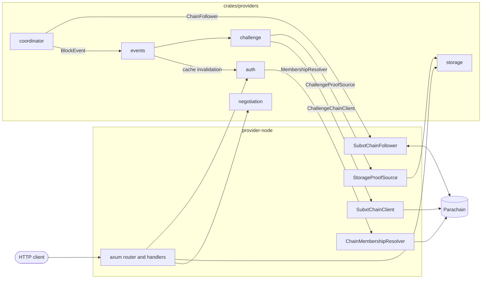

# Storage Provider Node

Off-chain HTTP server that handles data upload and download, builds MMR
commitments over stored chunks, and responds to on-chain challenges with
inclusion proofs.

## Architecture

`provider-node` is the binary that wires the crates in `crates/providers/` together.
The crates contain the logic and stay free of `subxt`.
`provider-node` implements their chain-facing traits with `subxt`, so a change of chain client stays inside this package.
Each crate describes its own workflow in its crate-level rustdoc (`cargo doc -p <crate> --no-deps --open`).



### HTTP request path

1. The axum router in `provider-node/src/api.rs` sends the request to a handler.
2. The handler calls `Authenticator::require_role` for the bucket and the role it needs (see the [`auth`](../crates/providers/auth/src/lib.rs) crate docs).
   Hash-keyed reads skip this step, see [Authentication](#authentication).
3. The handler reads or writes through `StorageBackend`, `FsIndexManager` or `S3IndexManager` (see the [`storage`](../crates/providers/storage/src/lib.rs) crate docs).
4. `POST /negotiate` takes a different route: an IP rate limit, then a check against `ChainState`, then a signature from the provider key (see the [`negotiation`](../crates/providers/negotiation/src/lib.rs) crate docs).

### Chain path

1. `ChainStateCoordinator` runs a reconnect loop and asks `SubxtChainFollower` for a connection (see the [`coordinator`](../crates/providers/coordinator/src/lib.rs) crate docs).
   The follower publishes each new connection to every other chain consumer.
2. For each finalized block, the coordinator updates `ChainState` and broadcasts the decoded `BlockEvent`s (see the [`events`](../crates/providers/events/src/lib.rs) crate docs).
3. `ChallengeResponder` reacts to `ChallengeCreated`, builds the proof from local storage and submits it through `SubxtChainClient` (see the [`challenge`](../crates/providers/challenge/src/lib.rs) crate docs).
4. The auth membership cache drops the entries of buckets whose membership changed.
5. After a reconnect, each of these services rescans chain state instead of trusting the events it missed.

### Startup order

`command::run` in `provider-node/src/command.rs` starts the node in this order:

1. Parse the CLI arguments and create the chain connection channel and the `BlockEvent` channel.
2. Connect to the chain once.
   A failure only logs a warning, and the coordinator retries in the background.
3. Build the storage backend and resolve the provider identity from the key file.
4. Build the `Authenticator`, subscribed to the `BlockEvent` channel before the coordinator starts.
5. Build `ProviderState` and, when a key file exists, `SubxtChainClient`.
6. Subscribe each background service to the `BlockEvent` channel, then start `ChainStateCoordinator`.
   This order lets every service receive the first `Resubscribed` event.
7. Start `ChallengeResponder` when `--enable-challenge-responder` is set and a chain client exists.
8. Sync the provider multiaddr on chain.
9. Bind the listener and serve the router.

## Build & Run

```bash
cargo build -p storage-provider-node --release
just start-provider   # requires a running chain (just start-chain)
just health           # check provider is up
```

## Signing key

The keypair derived from `--keyfile` signs commitments, checkpoint
co-signatures, negotiated terms, and replica sync attestations.
`--key-scheme` picks its scheme (`sr25519` default, `ed25519`, `ecdsa`,
`eth`), which must match the `public_key` registered on-chain — while they
differ, every signing endpoint returns `503 provider_key_mismatch`. The
registered key cannot be changed, so fix a mismatch by pointing the node at
the original key.

Extrinsics are always submitted from the sr25519 account derived from the
same seed: the provider's on-chain identity, independent of `--key-scheme`.

Signatures leave the node as SCALE-encoded `MultiSignature` in `0x` hex, so
the scheme tag travels with them (`0x01<64-byte sr25519>`,
`0x02<65-byte ecdsa>`).

## Storage backend

`--storage-backend` picks the storage engine (default `rocksdb`). Chunks and
MMR state go under `--storage-path` (`./provider-data`, or `$STORAGE_PATH`)
and survive a restart — a provider that forgot its data could not answer
challenges for buckets it still has agreements for.

## Authentication

Authentication is always enforced: every mutating Layer-0 endpoint (`PUT
/node`, `POST /commit`, `POST /delete`) and all fs/s3 endpoints require a
signed `Authorization` header, and there is no way to turn enforcement off.
Layer-0 reads that return a bucket's commitments, proofs or MMR shape
require the `Reader` role on a private bucket. Hash-keyed reads (`GET /node`,
`GET /read`, `GET /chunk_proof`, `POST /fetch_nodes`) take a `bucket_id` but
need no signature: the hash is the read capability. See "Read access at
Layer 0" in the [design doc](../docs/design/scalable-web3-storage.md).

The client signs an sr25519 message binding the request to a bucket and a
timestamp. Unlike provider signatures, client auth is sr25519-only;
[#304](https://github.com/paritytech/web3-storage/issues/304) tracks
extending it:

```text
signed message:  web3storage:<METHOD>:<bucket_id>:<timestamp>
header:          Authorization: Web3Storage <pubkey_hex>:<signature_hex>:<timestamp>
```

| Field          | Meaning                                                                 |
| -------------- | ----------------------------------------------------------------------- |
| `METHOD`       | Upper-case HTTP verb of the request (`GET`, `PUT`, `POST`, `DELETE`).   |
| `bucket_id`    | Decimal id of the bucket the request targets.                           |
| `timestamp`    | Client Unix time in **seconds**; identical in the message and header.   |
| `pubkey_hex`   | 32-byte sr25519 public key, hex (optional `0x` prefix).                 |
| `signature_hex`| 64-byte signature over the message, hex (optional `0x` prefix).         |

The recovered public key is mapped to the bucket's on-chain role
(`Reader` / `Writer` / `Admin`); reads need `Reader`, writes and deletes need
`Writer`, and pruning (`POST /delete`) needs `Admin`. The `timestamp` must be
within the configured skew window of the provider's clock or the request is
rejected as expired.

Bucket roles are cached, not read fresh on every request. A membership change
takes effect on the first request after the finalized block that carries it.
A feed that lags or reconnects invalidates every cached bucket immediately,
rather than waiting on the TTL; only a feed that stops running entirely (no
chain-state coordinator) falls back to `--auth-cache-ttl` (default 30s). If
the chain is unreachable when a lookup needs to refetch, the cached member
set is still served, but only for up to `--auth-max-stale` (default 5
minutes) - past that, the request is refused with `503`.

Because any keypair can ask about any bucket id, the cache is also capped at
`--auth-cache-max-entries` buckets (default 10,000), and entries are removed
rather than left stale: a member set at the stale bound, an empty one already
at the TTL. Eviction costs nothing but a re-resolve on the next request.

## Test

```bash
cargo test -p storage-provider-node
```

## License

Licensed under [GPL-3.0-only](../LICENSE-GPL3).
